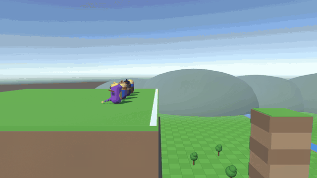

# Cómo planea un personaje

> Cuatro personajes, el mismo saliente y el mismo salto. ¿Quién llega más lejos?

## Qué muestra este proyecto
Cuatro formas de hacer que un personaje planee en un videojuego, todas lanzadas desde el mismo borde y con el mismo
salto, para que la diferencia se vea solo en la trayectoria:

| Método | Juego | Cómo funciona | Distancia (valores por defecto) |
|---|---|---|---|
| Descenso fijo | Spyro the Dragon | Cae a ritmo constante y avanza a velocidad fija | ~169 m |
| Caída frenada | Super Mario 3D Land (traje tanuki) | Gravedad reducida: sigue acelerando, pero más despacio | ~45 m |
| Física de picado | Batman: Arkham City | Picar convierte altura en velocidad; remontar la gasta | ~238 m (sin tocar nada, ~117 m) |
| Descenso fijo con resistencia | Zelda: Breath of the Wild | Como Spyro, pero la resistencia se agota; las corrientes de aire suben | ~87 m (con corriente, ~92 m) |

Todo lo que sale en pantalla es propio: los personajes son cápsulas de Unity "disfrazadas". Es una recreación propia a
partir de cómo se comportan los juegos; no se usa código, ni assets, de ningún estudio.

## Vídeo
- Vídeo completo: https://youtu.be/C-Q_E42IVYU
- Reels: _próximamente_

## Cómo probarlo
1. Clona el repositorio.
2. Ábrelo con Unity **6000.6.4f1** (Unity 6.4, plantilla Universal 3D / URP).
3. Abre `Assets/_Project/Scenes/00_Valle.unity` y pulsa Play.

### Controles
| Tecla | Acción |
|---|---|
| Espacio | Saltar (lanza al siguiente personaje de la fila) |
| R | Volver al saliente |
| W / S | Picar / tirar atrás (el picado de Batman) |
| P | Pausa |
| 1–4 | Velocidad de la simulación |
| T | Estelas y marcas de aterrizaje |
| V | Flechas de velocidad y gravedad |
| C | Cambiar de cámara (lateral → general → persecución) |
| U | Corrientes de aire (Link) |

Los parámetros de cada método (velocidad de caída, gravedad, ángulos, resistencia…) son `ScriptableObject`s en
`Assets/_Project/ScriptableObjects/Methods`: cámbialos con la simulación en marcha y mira cómo se mueve la trayectoria.

## Estructura
El código sigue capas con dependencias solo hacia dentro, un `asmdef` por capa (`Gliding.<Capa>`):
- `Assets/_Project/Scripts/Domain` — C# puro, sin `UnityEngine`: el estado de vuelo y la física de cada método.
- `Assets/_Project/Scripts/Application` — casos de uso (saltar, planear, aterrizar, turnos).
- `Assets/_Project/Scripts/Presentation` — vistas y gizmos (estelas, flechas, marcas); solo leen el estado.
- `Assets/_Project/Scripts/Infrastructure` — adaptadores de Unity, input, cámaras y punto de arranque.
- `Assets/_Project/Scripts/Tests/EditMode` — tests de Domain y Application.
- `Assets/_Project/Scenes` — la escena de demostración.
- `Docs` — imágenes y GIFs del README.

## Licencia
MIT — consulta [LICENSE](LICENSE).
